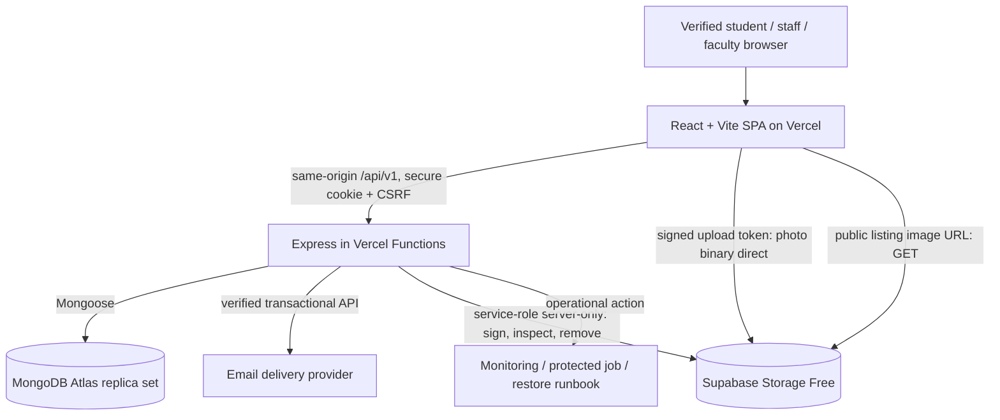
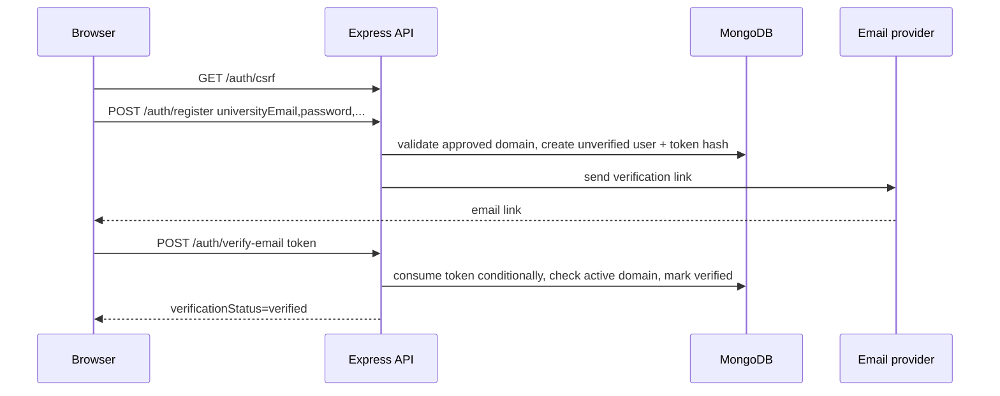
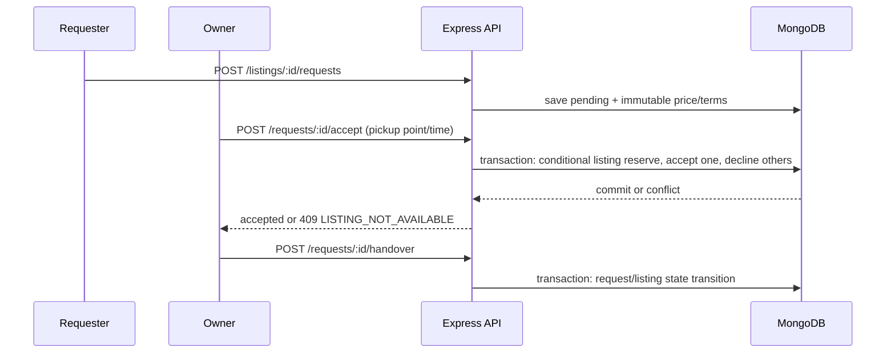
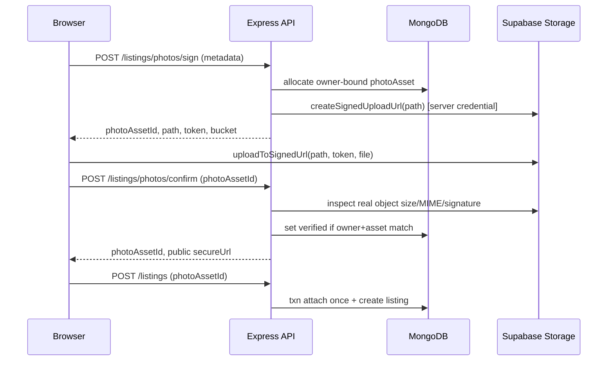

# UniCircle — FINAL System Architecture v3.0 (Codex Implementation Blueprint)

**Status:** Frozen internal implementation architecture, aligned with `PRD.md` v3.0, `DATABASE.md` and `openapi.yaml`. **Decision:** no Cloudinary; use **Supabase Storage Free exclusively for listing photos**. MongoDB Atlas remains the application's **only primary application database**. University signup uses `@seu.edu.bd`; deployment target Vercel. **No real services were provisioned or integrated by this document.**

## 1. Goals and boundaries

- Single university; one shared verified-member marketplace: sell, donate, rent, exchange and free borrowing.
- React/Vite/vanilla CSS frontend from existing ZIP. **Preserve working screens and layout; do not rebuild the UI.**
- Node.js + Express REST API `/api/v1` in Vercel Functions; Mongoose/MongoDB Atlas transaction-capable replica set.
- **Supabase Storage Free for photos only; do NOT use Supabase Auth or Supabase Postgres.**
- Email verification and reset via authenticated transactional email provider (sender/domain verification needed); never presume `seu.edu.bd` mail sending rights.
- One optional JPEG/PNG/WebP per listing, <= 5,242,880 bytes. No payment gateway, chat, university ID registration, account deletion, or public pickup details.

## 2. Context & container architecture



**Responsibilities:**

| Layer | Owns | Must never do |
|---|---|---|
| React/Vite | Forms, accessible UI, pending/error/empty states, photo preview, `Load More`, contract-driven HTTP client | Authorize requests, compute authoritative fees, persist production data to `localStorage`, store auth secrets |
| Express | Auth and sessions, CSRF, authorization, validation, DTOs, domain eligibility, photo authorization/verification, transaction orchestration | Proxy 5 MiB photo body through a Vercel Function or trust arbitrary client URLs |
| MongoDB Atlas | Users/domains, sessions, listings, requests, audit, photoAssets, request snapshots, partial unique indexes | Store uploaded binary/photo base64; store plaintext secrets |
| Supabase Storage | `unicircle-listings` bucket public **read**, signed-token upload **write only**, blob storage | Become the user database or grant general anonymous upload/delete/list permissions |
| Email provider | Send verified registration/reset emails | Assume an `@seu.edu.bd` From address without sender authorization |

Use same-origin routes whenever possible. If frontend and API are separate Vercel projects, configure **proven** rewrites/proxies so the browser still sees the same origin and cookies/CSRF remain correct. Secure cookie `uc_session`: HttpOnly, Secure, SameSite=Lax. All mutating endpoints require CSRF and origin verification.

## 3. Source layout (recommended, additive)

```text
repo/
  PRD.md
  ARCHITECTURE.md
  DATABASE.md
  API_CONTRACT.md
  openapi.yaml
  AGENTS.md
  frontend/                        # preserve ZIP code
    src/lib/apiClient.js
    src/services/{auth,listings,requests,admin,photos}.js
    src/mocks/                     # development only
  backend/
    src/app.ts                     # Express app export; no app.listen() in Vercel
    src/{routes,controllers,services,models,repositories,middleware,lib}/
    src/lib/supabaseStorage.ts     # server-only admin client, connection config
    tests/{unit,integration,contract}/
```

Local development may use `app.listen()` through separate entrypoint; Vercel exports the app/handler. Never assume local filesystem is durable. MongoDB connection is initialized lazily and reused across warm functions. Avoid in-memory sessions/locks and in-process cron.

## 4. Authentication + domain rules

1. User registers with `fullName`, `displayName`, `universityEmail`, `password`. Normalized email domain must **exactly** match active `approvedEmailDomains`, initially `seu.edu.bd`.
2. Password is hashed using Argon2id; account starts `unverified`. Verification token hash only in MongoDB, raw token in link; single-use, 60-minute expiry, resend <=5/account/rolling hour.
3. Verification checks that domain is **still active** when redeemed. Existing verified users may sign in even after domain deactivation.
4. Sign in only by university email/password. Session: 30-min idle, 7-day absolute, max 5 active sessions; cookie+CSRF, login failure lockout. `GET /auth/me` returns the own user; public DTOs include display name only.
5. Forgot Password uses registered university email: 30-min single-use token, generic answer for unknown email, revoke all sessions on successful reset.
6. Admin created by protected bootstrap; may manage only same-university official domains, hide listings with reason and use marketplace as member; cannot see private pickup for unrelated requests.

## 5. Photo storage: secure free-tier workflow (IMPORTANT)

**Bucket:** `unicircle-listings`, public read, *no anonymous write/update/delete/list*. Bucket max file size 5,242,880 bytes and allowed MIME `image/jpeg`, `image/png`, `image/webp`; Free plan global limit currently 50 MB, separate from stricter bucket limit. Every object key is generated by backend, e.g. `staged/<ownerObjectId>/<randomUUID>.jpg`; **do not trust uploaded filename as path**.

**Keep the two already-proposed REST endpoints, but change only their payloads:**

1. Browser validates type and `<=5 MiB` (user-friendly, not security boundary). `POST /api/v1/listings/photos/sign` with `{fileName,contentType,sizeBytes}` using login+CSRF.
2. Backend checks rate/owner, allocates `photoAssets` record `{_id,ownerId,storageKey,expectedSizeBytes,expectedContentType,status:'issued',issuedAt,...}` and calls Supabase's `createSignedUploadUrl(storageKey, {upsert:false})` using a **server-only service-role key**.
3. Response is `{data:{upload:{photoAssetId,bucket,path,token,expiresAt}}}`; Supabase signed upload token lasts **2 hours** by provider design. `expiresAt` reflects provider TTL. The backend may enforce a shorter `confirmBefore` for accepting the asset, but must not imply the provider token itself expires earlier.
4. Browser uses Supabase public SDK with publishable/anon key to call `.storage.from(bucket).uploadToSignedUrl(path,token,file,{contentType})`, **not** an Express multipart endpoint. Signing/confirmation and all other app traffic remain same-origin. **Never publish the service-role key.**
5. Browser calls `POST /api/v1/listings/photos/confirm` with `{photoAssetId}`. Backend looks up its own issued record by **authenticated owner**, fetches object metadata and verifies actual object size, MIME and magic-byte signature with a bounded byte-range read (JPEG/PNG/WebP) and key match. Metadata alone or the user-provided `sizeBytes` is not sufficient. Rejected uploads are deleted by server; clients cannot bypass by supplying `secureUrl`.
6. On successful confirmation, backend atomically marks asset `verified`, returns `{data:{photo:{photoAssetId,secureUrl}}}` with the public object URL derived from **trusted bucket+storageKey**. `POST /listings`/`PATCH /listings/:id` may attach that **one-time, same-owner** `photoAssetId` in an ownership-checked MongoDB transaction; mark `attached` and reject replay/reuse.
7. Edits remove/replace existing photo only after the listing update succeeds. Staged or rejected assets cleaned after 7 days by protected scheduled job/out-of-band maintenance (Supabase object deletion + MongoDB state); never run `setInterval` in Vercel Functions. Deleted/hidden/closed listing photo retention must follow PRD retention; unlink/delete media only when safe and without destroying authorized transaction snapshots.
8. If upload fails, preserve form data; allow retry or submit without image. Public listing images are *publicly viewable by URL* even though marketplace pages are authenticated: never put private pickup, contact data or identity scans in photos. Browser could include sensitive content; moderation/admin policy should address it.

**Why direct browser transfer?** Vercel Functions' default body limit (4.5 MB) is below accepted 5 MiB, so avoid routing raw photo bytes through API. Two JSON endpoints remain and 36 OpenAPI operations are unchanged.

## 6. Listing and request state invariants

- `listings.status`: `available` → `reserved` → (`completed` for sell/donate/exchange; `checked_out` for rent/free borrowing → `available` after return); `available` → `closed`. `isHidden` and `deletedAt` are orthogonal flags.
- A listing is feed-visible **only** when `status=available && !isHidden && !deletedAt`; newest first with signed cursor and default 20/maximum 50.
- Owner can edit/close/**soft-delete** only `available` + not hidden + not deleted; price/type/exchange-term edits cancel pending requests; close/delete cancel pending; history persists. Hidden owner may view reason but cannot act.
- Request snapshot stores price/terms on creation. Requester can't request own item or duplicate active request; rent/borrow pickup day cannot be past, return after pickup, max 365 days; return fee computed in integer poisha for Asia/Dhaka days.
- Owner acceptance requires future pickupAt and non-empty free-text pickupPoint. Acceptance reserves listing and declines other pending requests in **one MongoDB transaction**, with conditional update and partial unique index; only one winner under race. Pickup data only participants.
- Sell/donate owner records handover → completed. Exchange owner explicitly confirms **both** items exchanged → completed. Rent/borrow owner records handover → checked_out and later return → completed request + available listing (stays hidden if admin-hidden).
- Hidden reserved listing: accepted request cancelled, listing available-but-hidden. Hidden checked_out: retain outstanding return and don't reopen feed.

## 7. Main sequence diagrams

### Email verification


### Accepted request and handover


### Direct photo upload


## 8. Data/visibility model

- `UserSelf` returns own university email; public `OwnerPublic` returns `{id,displayName}` only.
- API responses require auth for listing feed/details, requests and activity; never leak hashed tokens, passwords, other users' email, raw private pickup data, admin audit payloads.
- Asset URLs in listing cards may be publicly readable. Treat only non-sensitive item imagery as uploadable.
- All API writes reject arbitrary additional fields; use canonical snake_case enum values, 24-character MongoDB ObjectId IDs, fixed 2-decimal money strings and UTC timestamps.
- `PhotoAsset` ID is not upload token; upload tokens must not appear in logs or be reused in listing DTOs.

## 9. Scale, resilience, observability

- P95 feed/search target < 2s at 1,000 listings and 10 concurrent users; index-assisted filter/sort and title search. Monitor rate-limited responses and function errors.
- DB index migration should be an explicit deploy step, not automatic app startup; Atlas transactions require replica set.
- Rate-limit authentication, email and image signing; reject malformed ObjectIds, oversized metadata, forged cookies and CSRF. Log request IDs and safe error codes, avoid token/URL-with-upload-token logs.
- Use UTC clocks and Asia/Dhaka for campus dates, avoid local machine timezone arithmetic.
- Daily MongoDB backups with 30-day retention and tested restore are an **operational target**. Free Atlas tiers may not include automated backups; implement and verify a safe external job before claiming this target met.
- External mail delivery may have free-tier caps and domain verification; use real provider checks before production.
- Supabase Free: 1 GB file storage, 5 GB cached + 5 GB uncached egress, max 50 MB per upload on Free (UniCircle enforces 5 MiB). Supabase Free projects may pause after a week of inactivity. Monitor quota, reserve space, and plan upgrade/migration as user count grows.
- **Vercel Hobby is for personal/non-commercial deployments only.** This marketplace includes sale/rental flows; treat Hobby as a development preview pending operator confirmation and use a compliant plan for actual commercial production.

## 10. Deployment, CI and quality gates

1. Set Vercel SPA build output and `/api/v1` route to backend function; verify direct reload on React Router pages.
2. Configure Atlas, Supabase Storage bucket, email provider, environment secrets in appropriate backend/project scopes; no credentials checked in.
3. Add CI: frontend tests/build, backend unit+integration against real Mongo replica-set, request/response OpenAPI schema validation, IDOR/CSRF/security tests, live Supabase staging upload test.
4. Validate all 36 API operations, 50 repeated parallel-accept races, soft delete and cancellation, hidden checked_out return, 5 MiB boundary, invalid magic signatures, wrong-owner photo reuse, 20+Load More.
5. Test backup/restore and reset-email delivery; document known external provider quotas, deployment compliance and rollback.

## 11. Source links checked 2026-11-23

- Supabase Free limits: https://supabase.com/pricing
- Direct signed upload token (2 hours): https://supabase.com/docs/reference/javascript/storage-from-createsigneduploadurl
- Browser uploadToSignedUrl: https://supabase.com/docs/reference/javascript/storage-from-uploadtosignedurl
- Supabase projects pause on free after inactivity: https://supabase.com/pricing
- Vercel Function upload limit/client upload rationale: https://vercel.com/docs/functions/limitations
- Vercel Hobby noncommercial restrictions: https://vercel.com/docs/limits/fair-use-guidelines

## 12. Document ownership and implementation authority

- `PRD.md` owns product policy and acceptance criteria; `API_CONTRACT.md` + `openapi.yaml` own HTTP; `DATABASE.md` owns fields/indexes; this document owns architecture and deployment; `AGENTS.md` instructs Codex execution.
- Treat the source HTML as a reference demo. The **React ZIP** is the actual frontend source: retain `frontend/src/*.jsx|js|css` while creating API adapters and new required UI states.
- No services, credentials or workflows have been provisioned simply by writing this document. Launch is blocked until provider limits/commercial terms, domain authority, email delivery, index migrations, restore tests and all PAC checks are confirmed by real tests.
